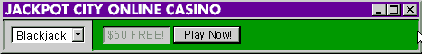

  

  

<table align="center" width="100%" cellspacing="0" cellpadding="5">
  <tbody>
    <tr>
      <td colspan="2">
        

          
        

        

         Hi!!! My name is $\huge\color{	#FF00FF}{\mathcal{ALLEN}}$
           
          i like to break stuff... and i make no mistakes
        

        <ul align="center">
          <li>doing web dev</li>
          <li>learning game dev (learning Godot)</li>
          <li>misses the old web</li>
        </ul>
        

          
        

      </td>
      <td align="center">
        
      </td>
    </tr>
    <tr>
      <td align="center" colspan="3">
        
        
        
        
        
      </td>
    </tr>
  </tbody>
</table>

<table align="center">
  <tbody align="center">
    <tr>
      <td colspan="1">
      

        
      

      </td>
      <td colspan="2">
        

          
        

      </td>
    </tr>
    <tr>
      <td align="center"><strong>Languages</strong></td>
      <td>HTML, CSS, Javascript/Typescript, Python, Bash, C</td>
    </tr>
    <tr>
      <td align="center"><strong>Web Dev</strong></td>
      <td>NodeJS, Express, React, Tailwind, Git</td>
    </tr>
    <tr>
      <td align="center"><strong>Data & Cloud</strong></td>
      <td>PostgreSQL, AWS, Azure, Docker, Vagrant</td>
    </tr>
  </tbody>
</table>

<table cellspacing="0">
  <tr>
    <td colspan="1">
      
    </td>
    <td colspan="1">
        
    </td>
    <td colspan="1">
      
    </td>
  </tr>
</table>

<table align="center">
  <tbody>
    <tr>
      <td align="center">
        <h3>$\huge\color{	#bdbd14}{\mathbb{Favourite Pokemon}}$</h3>
        

          
          
          
        

      </td>
      <td align="center">
        <h3>$\huge\color{	#109f42}{\texttt{Cactus Garden}}$</h3>
        

          
          
          
          
          
        

      </td>
      <td align="center">
        <h3>$\huge{\text{dog}}$</h3>
        

          
        

      </td>
    </tr>

  </tbody>
</table>
